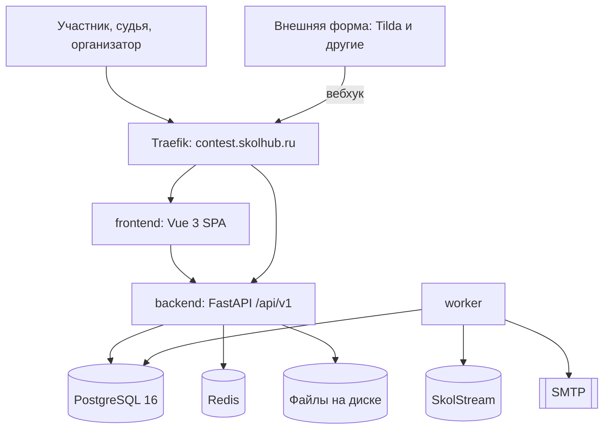

# Архитектура

## Сервисы



| Сервис | Стек | Назначение |
|---|---|---|
| `backend` | Python 3.12, FastAPI, SQLAlchemy 2 async, Alembic, Pydantic 2 | REST API, бизнес-логика, права |
| `worker` | тот же образ, arq на Redis | письма, синхронизация SkolStream, напоминания |
| `frontend` | Vue 3, Pinia, Vue Router, Tailwind 4, Vite | открытая форма заявки, оргкомитет, кабинет участника, судья, анонимная оценка |

Инфраструктура: PostgreSQL 16, Redis, файлы на диске сервера (Docker volume), Mailpit в разработке. Деплой в Coolify, прокси coolify-proxy (Traefik).

## Структура репозитория

```
backend/
  app/
    core/          конфиг, файловое хранилище, общие части писем
    legacy/        перенос истории из NocoBase
    modules/
      auth/        вход: из sk-common, здесь режим судьи
      events/      мероприятия, направления, этапы, команда
      applications/заявки: первый шаг, вебхук, модерация, анкета (docs/registration.md)
      files/       загрузка файлов и права на них
      stages/      участие в этапах, правила перехода, итоги, дипломы
      evaluation/  шкалы, таблицы, листы, оценки, подсчёт
      reminders/   напоминания по расписанию
      system/      проверка состояния
    workers/
  migrations/
  tests/
frontend/
infra/             compose и скрипт для Coolify, nginx
docs/
```

Люди, вход и журнал действий — из общего пакета `sk-common`.
Роутеры тонкие, логика в сервисах, транзакция на запрос.

## Принципы

- **Права на сервере.** Каждый эндпоинт проверяет роль пользователя в конкретном мероприятии. Фронтенд только прячет недоступное.
- **Подсчёт в одной транзакции.** Изменение оценки сразу пересчитывает оценку судьи, балл работы и ранги листа. Фоновых пересчётов и workflow нет.
- **Аудит.** Изменения оценок, статусов заявок и итогов пишутся в `audit_log`.
- **Ключи.** `bigint` из функции PostgreSQL `next_id()`: миллисекунды с 2020-01-01 (41 бит) + счётчик (12 бит). Число помещается в 53 бита и безопасно для JavaScript, а новые ID всегда больше ID из NocoBase, поэтому архив переносится с исходными ID. Внешние ID SkolStream хранятся как `uuid` в `skolstream_id`.
- **Файлы.** На диске в volume, в БД метаданные. Работа с файлами только через `app/core/storage.py`, чтобы хранилище можно было заменить без правок модулей. Публичные файлы (обложки мероприятий) API отдаёт с `Cache-Control`.
- **Публичные формы.** Капча (Yandex SmartCaptcha) и ограничение частоты запросов. Вебхук защищён секретом в адресе и лимитом на мероприятие.

## Адреса

| Адрес | Что |
|---|---|
| `contest.skolhub.ru` | приложение и API (`/api/v1`) |
| `contest.skolhub.ru/apply/<адрес>` | открытая форма заявки |
| `contest.skolhub.ru/api/v1/public/webhooks/<секрет>` | заявки из внешних приложений |
