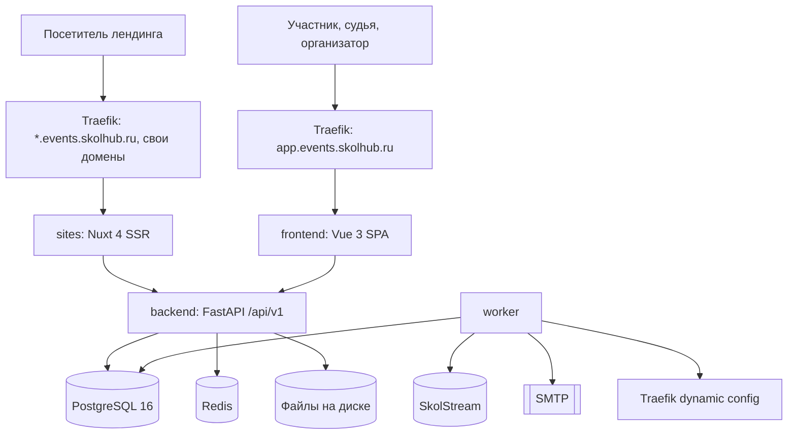

# Архитектура

## Сервисы



| Сервис | Стек | Назначение |
|---|---|---|
| `backend` | Python 3.12, FastAPI, SQLAlchemy 2 async, Alembic, Pydantic 2 | REST API, бизнес-логика, права |
| `worker` | тот же образ, arq на Redis | письма, PDF, синхронизация SkolStream, выпуск доменов |
| `frontend` | Vue 3, Pinia, Vue Router, Tailwind 4, Vite | оргкомитет, кабинет участника, судья, анонимная оценка, редактор лендингов |
| `sites` | Nuxt 4 SSR | публичные лендинги по заголовку Host |
| `packages/blocks` | Vue 3 | компоненты и схемы блоков, общие для редактора и `sites` |

Инфраструктура: PostgreSQL 16, Redis, файлы на диске сервера (Docker volume), Mailpit в разработке. Деплой в Coolify, прокси coolify-proxy (Traefik).

## Структура репозитория

```
backend/
  app/
    core/          конфиг, БД, безопасность, логирование
    modules/
      auth/        вход SkolStream, magic-link, сессии
      people/      users, persons, classes, departments
      events/      мероприятия, направления, этапы, шаблоны
      forms/       конструктор анкет
      applications/заявки, модерация, кабинет
      stages/      участие в этапах, правила перехода, слоты
      evaluation/  шкалы, таблицы, листы, оценки, подсчёт
      results/     рейтинги, публикация, дипломы
      sites/       лендинги, блоки, домены
      integrations/skolstream, nocobase-импорт
    workers/
  migrations/
  tests/
frontend/
sites/
packages/blocks/
infra/             compose, шаблоны Traefik, бэкапы
docs/
```

Каждый модуль backend устроен одинаково: `models.py`, `schemas.py`, `repository.py`, `service.py`, `router.py`, `permissions.py`.
Роутеры тонкие, логика в сервисах, транзакция на запрос через unit of work.

## Принципы

- **Права на сервере.** Каждый эндпоинт проверяет роль пользователя в конкретном мероприятии. Фронтенд только прячет недоступное.
- **Подсчёт в одной транзакции.** Изменение оценки сразу пересчитывает оценку судьи, балл работы и ранги листа. Фоновых пересчётов и workflow нет.
- **Аудит.** Изменения оценок, статусов заявок и итогов пишутся в `audit_log`.
- **Ключи.** `bigint` из функции PostgreSQL `next_id()`: миллисекунды с 2020-01-01 (41 бит) + счётчик (12 бит). Число помещается в 53 бита и безопасно для JavaScript, а новые ID всегда больше ID из NocoBase, поэтому архив переносится с исходными ID. Внешние ID SkolStream хранятся как `uuid` в `skolstream_id`.
- **Файлы.** На диске в volume, в БД метаданные. Работа с файлами только через `app/core/storage.py`, чтобы хранилище можно было заменить без правок модулей. Публичные картинки лендингов отдаются через `sites` с ресайзом.
- **Публичные формы.** Капча (Yandex SmartCaptcha) и ограничение частоты запросов.

## Домены

| Адрес | Что |
|---|---|
| `app.events.skolhub.ru` | приложение и API (`/api/v1`) |
| `events.skolhub.ru/<slug>` | простая страница мероприятия |
| `<slug>.events.skolhub.ru` | лендинг, wildcard-сертификат через DNS-01 |
| свой домен | лендинг, CNAME + сертификат HTTP-01 через динамическую конфигурацию Traefik |

Адреса предварительные, см. [decisions.md](decisions.md).
