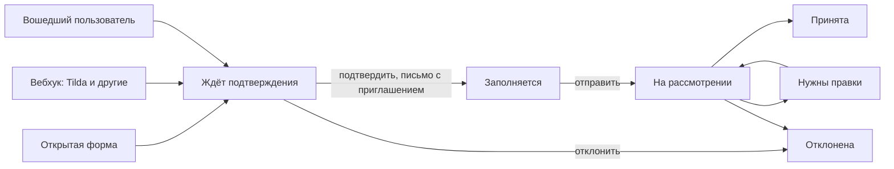

# Приём заявок

Заявка проходит два шага. Сначала человек оставляет короткую общую заявку, модератор её подтверждает, и только потом участник заполняет анкету в личном кабинете: руководителей, тезисы, файлы.



| Статус | Значение |
|---|---|
| `requested` | общая заявка ждёт модератора, учётной записи может ещё не быть |
| `draft` | подтверждена, участник заполняет анкету |
| `submitted`, `needs_changes`, `accepted`, `rejected`, `withdrawn` | рассмотрение анкеты, как раньше |

Если у мероприятия выключено «Заполнение анкеты после подтверждения», подтверждённая заявка сразу становится принятой. Так настроены открытые события по умолчанию: слушателям нечего дописывать.

Настройка — вкладка «Форма заявки» в разделе «Подготовка» мероприятия. Новые заявки принимаются в окне приёма; дописывать подтверждённые можно до даты «Заполнить анкету до», а если она пуста — пока идёт приём.

## Откуда приходят заявки

- **Открытая форма** — страница `/apply/<адрес мероприятия>`, вход не нужен. Спрашивает ФИО, email, согласия и то, что выбрал организатор: телефон, школу, класс, название работы, направление, форму участия и вопросы анкеты с отметкой «В общей заявке». Файлы — только в кабинете. Защита: капча и лимит по адресу. Повторная отправка с тем же email, пока заявка ждёт подтверждения, копию не создаёт.
- **Вошедший пользователь** — та же страница, ссылки есть в «Мои заявки». ФИО и email берутся из учётной записи, заявка сразу связана с ней. Сюда же попадают те, кто участвовал раньше или входит через SkolStream. Если выключить «Открытую форму», заявку смогут подать только вошедшие.
- **Вебхук** — заявки из внешних приложений, см. ниже.
- **Оргкомитет** — кнопка «Добавить заявку», для приёма на месте и заявок по почте; минует первый шаг.

## Модератор и связь с человеком

В карточке заявки на первом шаге видно, что указал человек, откуда пришла заявка и исходные данные из внешней формы. Модератор может:

- исправить контакты, например опечатку в адресе;
- присоединить заявку к человеку из базы: подсказки строятся по совпадению email и ФИО, есть поиск. Учитываются участники прошлых мероприятий и люди из справочника SkolStream, даже если они ни разу не входили: учётная запись появится при присоединении;
- снять связь, пока заявка не подтверждена, или позже передать заявку другому человеку;
- подтвердить или отклонить заявку, в том числе несколько сразу.

При подтверждении заявка без связи находит человека по email: существующего или нового внешнего участника. Без email подтвердить нельзя, пока модератор не укажет адрес или не присоединит человека. Письмо-приглашение содержит одноразовую ссылку на 7 дней, которая сразу открывает заявку; при необходимости модератор отправляет новую. Письмо идёт на адрес учётной записи, поэтому посторонний, указавший чужой email, доступа к кабинету не получит.

## Вебхук

Организатор включает его на вкладке «Форма заявки» и получает адрес вида:

```
https://contest.skolhub.ru/api/v1/public/webhooks/<секрет>
```

Секрет в адресе — единственный ключ: его можно сменить, прежний адрес перестанет работать. Принимается `POST` в формате формы или JSON, успешный ответ — `200` и текст `ok`.

**Tilda.** Настройки сайта → Формы → Webhook: вставить адрес, подключить его к форме в настройках блока. Проверочный запрос Tilda (`test=test`) заявку не создаёт, а номер `tranid` защищает от повторной доставки.

Как распознаются поля, по порядку:

1. Соответствие из настроек вебхука: наше поле → имя поля во внешней форме.
2. Вопросы анкеты: по ключу или подписи вопроса без учёта регистра.
3. Распространённые названия: `Name`, `ФИО`, `Email`, `Phone`, `Телефон`, `Школа`, `Класс`, `Направление` и другие (`ALIASES` в [webhook.py](../backend/app/modules/applications/webhook.py)).

Значения, которые не удалось разобрать, например неверный email или неизвестное направление, не теряются: они остаются в исходных данных заявки. Согласия во внешней форме не проверяются, участник даёт их в кабинете перед отправкой анкеты.

| Ответ | Когда |
|---|---|
| `200 ok` | заявка принята, повторная доставка или проверочный запрос |
| `404` | неизвестный или отключённый адрес |
| `409` | мероприятие в черновике, архиве или на этапе итогов |
| `413` | тело больше 64 КБ |
| `422` | нет ни имени, ни email |
| `429` | больше 600 заявок в час |

После закрытия окна приёма вебхук продолжает принимать заявки, пока мероприятие в статусе «Регистрация» или «Идёт»: человек на внешнем сайте уже отправил форму, решение остаётся за модератором.

## Код

| Файл | Что внутри |
|---|---|
| `applications/registration.py` | создание общей заявки из формы и вебхука |
| `applications/webhook.py` | разбор данных внешних форм |
| `applications/moderation.py` | решения, подтверждение, связь с человеком |
| `applications/notifications.py` | письма заявителю и приглашение |
| `applications/service.py` | анкета в кабинете, заявка от оргкомитета, список |
| `applications/registration_router.py`, `router.py`, `router_common.py` | API |
